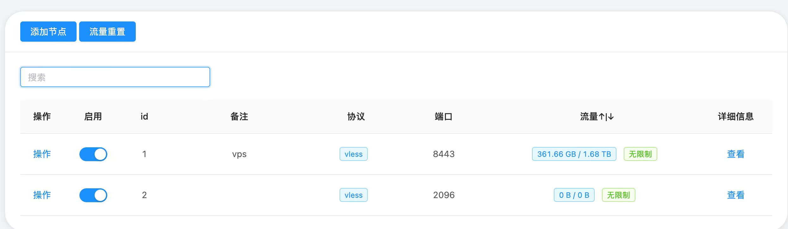

# 初始需求：搭建自己的代理服务，并理解它如何工作

这是 AI 根据用户填写稿及对话补充整理的正式需求入口。它保存目标和上下文，不代表技术方案已经核实或任务已经完成。

## 用户最初想达到什么

从购买服务器开始，搭建一套自己实际可用的代理服务；同时能说清核心流程、理解关键技术，留下新手可复现的步骤。学习 Qv2ray 是理解这套流程的入口。

后续方案可以调整，但不能把“自己能用、理解原理、能复现”悄悄改成只安装一个工具。若用户改变目标，在本文末尾记录原因，保留这一初始目的。

## 用户希望怎样推进

朋友已经有一套稳定的方案。先调研朋友使用的工具、服务器和连接流程，再做必要的 POC，逐步购买、搭建和验证自己的服务。实际操作中解释原因，最后结合真实步骤整理学习记录。

当前资料保存在本 GitHub 仓库，后续再迁移到 Obsidian。五步规划见 [任务总览](AGENTS.md)；每项任务的后续产物归入对应 Task 目录。

## 已有上下文

- 朋友参考的项目：[yonggekkk/x-ui-yg](https://github.com/yonggekkk/x-ui-yg)。用户说明该项目服务已部署在朋友服务器上，AI 尚未核验实际版本。
- SSH 入口：`ssh root@104.244.92.199`。用户说明可以直接连接，AI 尚未实测。
- 服务面板：http://104.244.92.199:5453/91f/
- 面板凭据已在原对话中提供，不存入 Git；独立 Agent 需要时经私密渠道取得，不能将面板凭据当作 SSH 凭据。

### 用户提供的面板截图

附件随需求一起保存，使用仓库内相对路径，不依赖聊天附件的本机临时位置。

截图显示：ID 1 备注为 `vps`，端口 `8443`；ID 2 端口 `2096`；两项均显示为启用的 VLESS 节点。截图只能证明当时展示的信息，不能替代实时连通验证，也不能据端口推断 TLS 或传输方式。

## 还需要补充或验证

目标设备、预算和其他限制尚未填写，用户已有实践基础尚未说明。朋友服务的实际版本、传输方式、TLS 设置、客户端连接方式，以及 Qv2ray 的具体角色，都留待调研，不作为已确认事实。

以上“尚未核验”描述保留需求接收时的背景。2026-10-12 用户开启调研后，已研究公开资料、尝试 SSH 并读取面板配置；当前核验结果统一见 [01 调研结果](tasks/01-调研朋友的方案/result.md)。购买、安装、修改服务和下一项 POC 均未执行。

## 来源与后续变化

- 2026-10-11：根据 [原填写稿](archive/intake/problem.template.md) 和本次对话补充整理。面板截图来自用户提供的附件，原图保存为 `assets/friend-panel.jpg`。
- 根目录填写副本已移入 `archive/intake/`，供追溯原话。后续以本文件为需求入口；新增目标或重要背景在此补充并记录变化，各 Task 不复制维护另一份需求。
