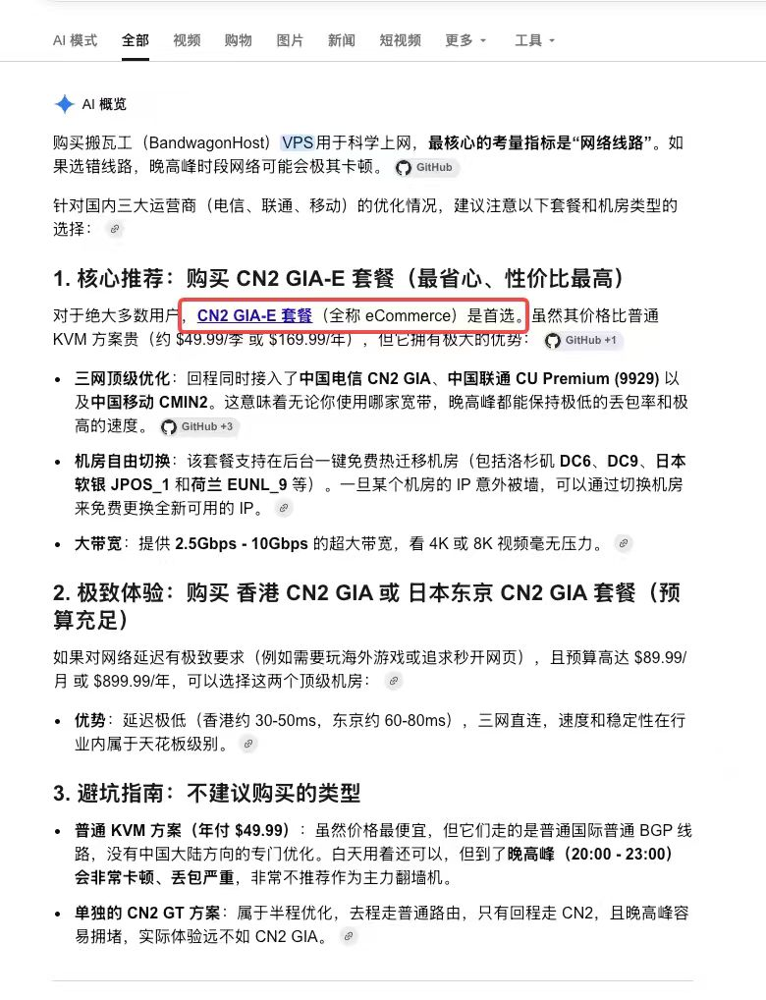

# 朋友推荐：搬瓦工 CN2 GIA-E

2026-10-12 用户提供截图，表示“朋友给我推荐了这个”。

截图为搜索页 AI 概览，突出 CN2 GIA-E（eCommerce）套餐，声称约 US$49.99/季或 US$169.99/年，并描述优化线路、机房迁移和端口带宽。它不是商家订单、官方条款或用户网络测速。

核验边界：CN2 GIA-E 的定位是优化线路，不能据此认定住宅IP。截图中低丢包、高峰稳定、4K/8K、迁移换IP等说法不作为保证。此前本站文章查得US$49.99/季；按四季度付款约US$199.96，不排除存在不同年付价格，但截图US$169.99年付必须匹配具体官方SKU核对，不能据截图直接下单。

用户提供推荐线索，尚未明确撤销Cloudflare路线或住宅出口偏好，也未授权购买。优先将该具体套餐与住宅候选比较，区别直连线路投入与出口IP属性。
